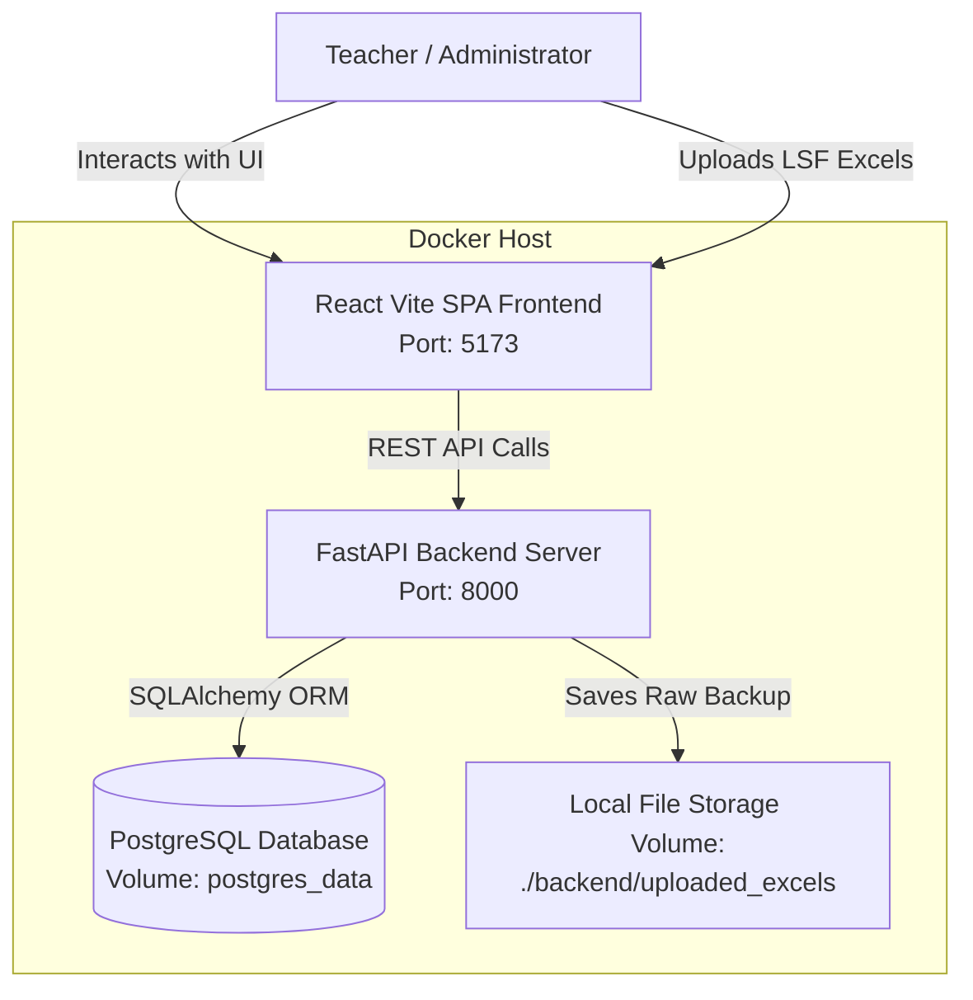
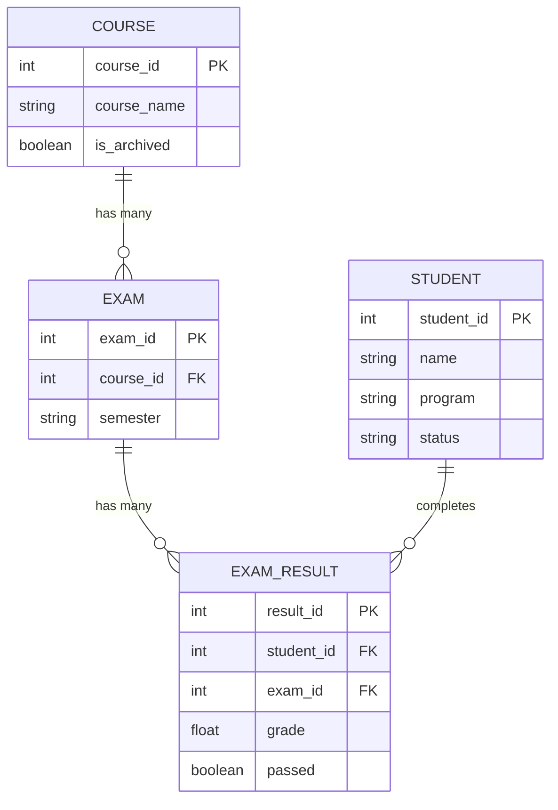
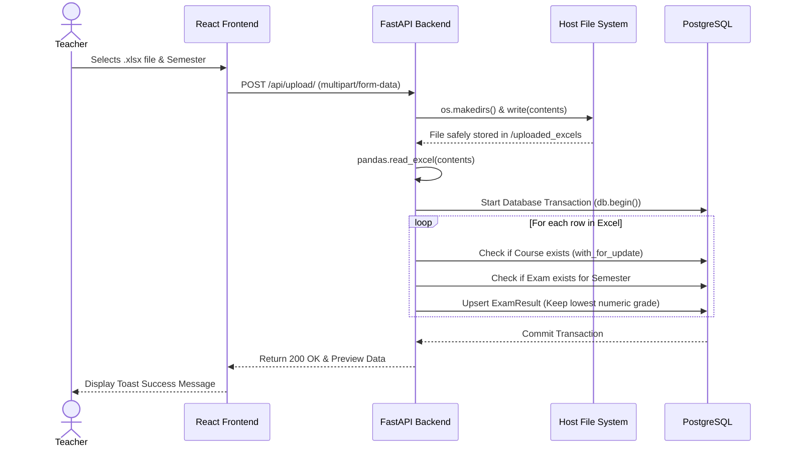

# Software Architecture & UML Specifications

This document outlines the high-level system architecture and data models for the SPA (Study Progress Analysis) System.

## 1. High-Level Architecture (C4 Context)

The system follows a standard modern web application architecture isolated via Docker containers.

## 2. Entity Relationship Diagram (ERD)

The database strictly models the many-to-many relationship between Students and Courses through the intermediate `ExamResult` and `Exam` entities.

## 3. Upload & Thesis Data Flow (Sequence Diagram)

This sequence demonstrates the core business logic of data ingestion, including the fallback saving mechanic to ensure persistency.

## 4. Technology Stack

- **Frontend:** React 18, Vite, Material-UI (MUI), AG Grid (for data tables), Recharts (for dashboards).
- **Backend:** Python 3.10+, FastAPI, SQLAlchemy, Pandas (for ETL / ingestion), Uvicorn.
- **Database:** PostgreSQL 15.
- **Infrastructure:** Docker, Docker Compose (3 containers linked via bridge network).
