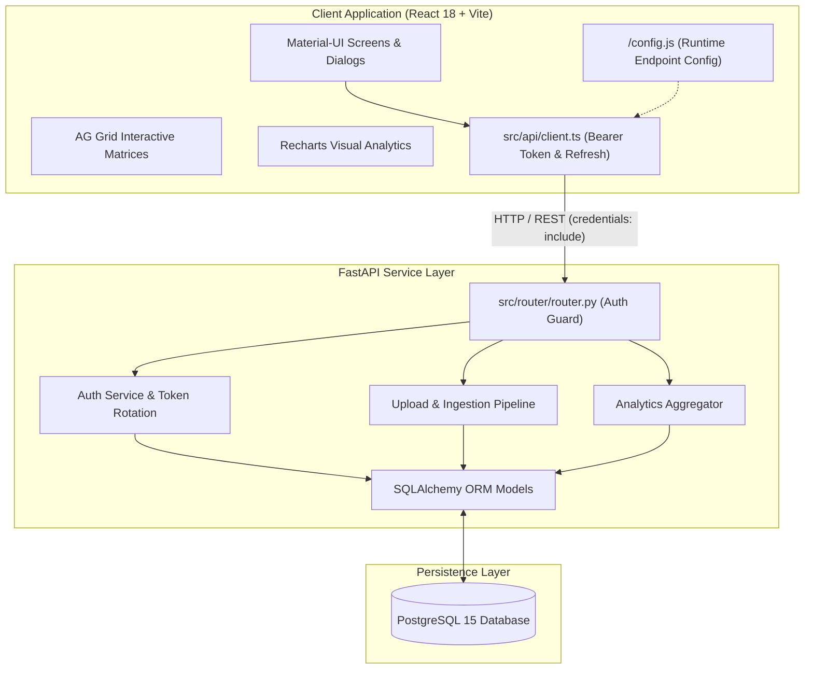
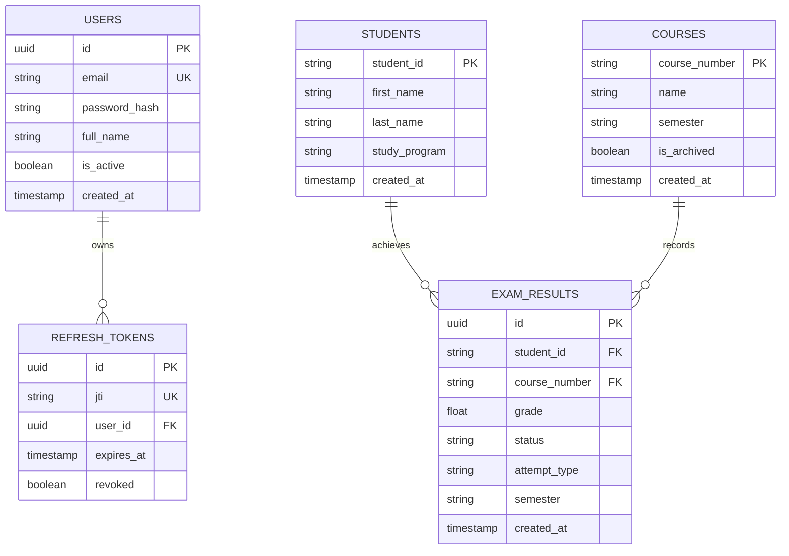

# System Architecture & Technical Specifications

The Study Progress Analysis (SPA) platform is built on a modern decoupled architecture where the client holds no database credentials or business rules, communicating exclusively with the backend service over a RESTful HTTP API.

---

## 🏗️ Technology Stack

| Layer | Technology | Primary Responsibilities |
| :--- | :--- | :--- |
| **Frontend Client** | React 18, TypeScript 5, Vite | Interactive UI, exam data inspection, responsive dashboards, AG Grid data matrices. |
| **UI Components & Theme** | Material-UI (MUI v5) | University-branded layout, Dark/Light modes, form dialogs, accessible controls. |
| **Data Grids & Tables** | AG Grid Community | High-performance editable spreadsheets, column sorting, filtering, selection. |
| **Data Visualizations** | Recharts | Grade distribution histograms, student trendlines, pass/fail donuts. |
| **State Management** | Zustand | Light-weight reactive stores (`authStore`, `themeStore`, `studyProgramStore`, `systemLogStore`). |
| **Backend REST API** | FastAPI (Python 3.11) | High-speed async REST endpoints, request validation, CORS security, token issuance. |
| **Data Validation** | Pydantic v2 | Strict DTO schemas, input sanitization, university domain validation. |
| **ORM & Database** | SQLAlchemy 2.0 & PostgreSQL 15 | Relational data persistence, atomic transaction rollbacks, relational integrity. |
| **Schema Migrations** | Alembic | Tracked schema evolution with automatic startup migration runs (`run_migrations()`). |
| **Containerization** | Docker, Docker Compose, Nginx | Multi-stage builds, runtime config injection via `/config.js`, container registry distribution. |

---

## 🗄️ Database Entity-Relationship (ER) Model

---

## 🔒 Security Architecture

1. **Authentication Token Lifecycle:**
   - **Access Token:** Short-lived (15 minutes), passed as `Authorization: Bearer <token>`, held in client memory only (never written to `localStorage` or readable cookies).
   - **Refresh Token:** Long-lived (14 days), delivered as an `httpOnly` cookie scoped to `/api/auth`. Rotated automatically on every refresh request.
2. **CORS Hardening:**
   - Strict origin matching (`CORS_ORIGINS`). Trailing slashes are stripped.
   - Wildcards (`*`) are disallowed because credentialed requests (`credentials: 'include'`) are required by modern browser security standards.
3. **Password Security:**
   - Passwords hashed using `bcrypt` with individual salts and configurable work factor (`BCRYPT_ROUNDS=12`).
   - Plaintext passwords never touch persistence.
