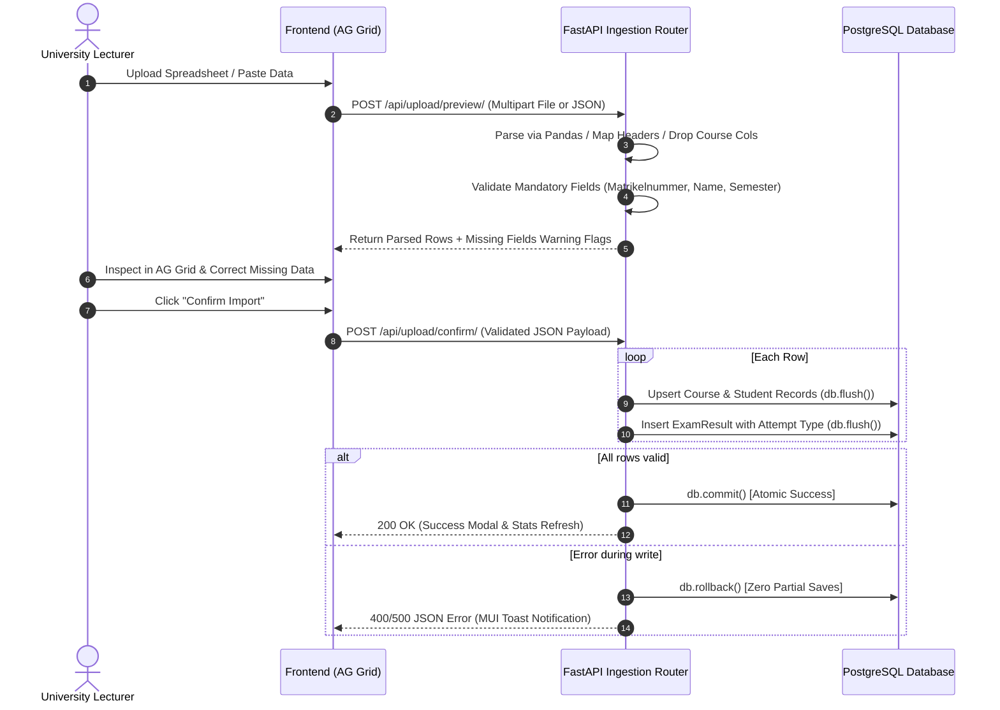

# Backend Service Architecture

> 📌 **Backend Service Repository:**
> The backend implementation, database models, and migrations are maintained in:
> 🔗 **[`d2-project-backend`](https://gitlab.gwdg.de/sudarshan.bashyal/d2-project-backend)**

The backend is built with **FastAPI**, **SQLAlchemy**, and **PostgreSQL 15**, providing a high-throughput, ACID-compliant API service for academic ingestion and analytics.

---

## 📁 Source Code Organization

```
d2-project-backend/
  main.py                FastAPI application instance, startup migration hooks, CORS setup
  config.py              Centralized environment configuration and normalization
  dependencies.py        FastAPI dependency injection (get_db, get_current_user)
  database.py            SQLAlchemy async/sync engine, sessionmaker, schema safety
  models.py              Declarative ORM models (User, Student, Course, ExamResult, RefreshToken)
  schemas.py             Pydantic v2 validation DTOs and request/response contracts
  seed.py                Realistic academic seed dataset for empty database initialization
  routers/
    auth.py              Registration, login, cookie rotation, account info
    courses.py           Course catalogue, details, creation, update, archival
    students.py          Student roster, profiles, academic transcripts, trajectory status
    grades.py            Mark updates, historical exam edits, grade audit trails
    upload.py            Spreadsheet previewing, column mappings, atomic ingestion confirm
    stats.py             Longitudinal pass-rates, grade curves, dashboard KPI metrics
  migrations/            Alembic database migration versions and environment scripts
  tests/                 Pytest test suites (unit, integration, and security checks)
```

---

## ⚡ Data Ingestion Pipeline & Atomic Guarantees

The ingestion service (`routers/upload.py` and `services/ingestion.py`) handles multi-format file parsing (`.xlsx`, `.csv`, `.tsv`, `.ods`) through a 2-phase process:



---

## 🛡️ CORS Normalization & Allowed Origins

To guarantee strict security while allowing flexible server deployments:
* The backend reads `CORS_ORIGINS` from `.env`.
* In `config.py`, origins are parsed and trailing slashes are automatically stripped:
  ```python
  CORS_ORIGINS = [orig.strip().rstrip("/") for orig in os.getenv("CORS_ORIGINS", "").split(",") if orig.strip()]
  ```
* Because authentication requests utilize `httpOnly` refresh cookies (`credentials: 'include'`), wildcards (`*`) are prohibited by browser CORS specifications.
