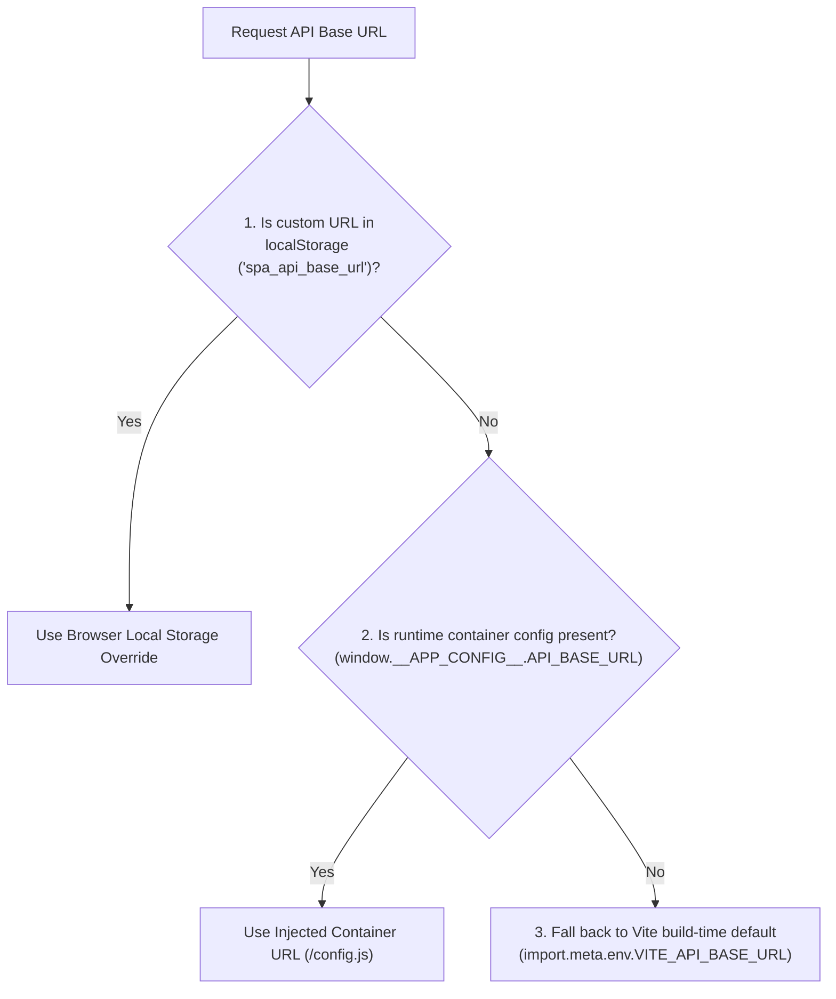

# Frontend Client Architecture

The frontend client is a strict single-page application built with **React 18**, **TypeScript 5**, and **Vite**, adhering to modern modular patterns and UI quality gates.

---

## 📁 Source Code Organization

```
src/
  api/                    Centralized HTTP API integration layer
    client.ts             Base URL resolver, Axios/Fetch instance, 401 refresh interceptor
    auth.ts               Sign in, sign up, logout, current user profile
    courses.ts            Course catalogue, details, creation, marks retrieval
    grades.ts             Exam marks modification and audit log tracking
    stats.ts              Aggregated KPI stats for dashboards
    students.ts           Student directory, CRUD, transcript histories
    uploads.ts            Multipart file upload preview & atomic confirm
  components/
    common/               Reused UI components (UniHildesheimLogo, StatCards, PillowBadges)
    drive/                Course Drive file manager and file detail inspector
    features/             Full-screen domain feature views
      auth/               LoginForm, RegisterForm, AuthLayout, AuthSettingsDialog
      batchUpload/        Multi-step batch upload wizard, column mapping, review
      courseDetail/       Course header hero card, marks table, exam comparisons
      settings/           SettingsDialog, BackendApiConnectionSection, ProfDinoGame
      AnalysisHub.tsx     Visual analytics dashboard and student trajectory charts
      CourseDetail.tsx    Course overview, Drive files, and detailed marks
      CoursesAdmin.tsx    Course administrative catalogue
      StudentDetail.tsx   Student profile and longitudinal transcript
      SystemLogs.tsx      System audit logs and incident inspector
    forms/                StudentFormDialog, EditCourseDialog, ManualMarkDialog
  hooks/
    useAppLogic.tsx       Global application state and navigation controller
    useApi.ts             Typed API mutation and query hooks
  stores/                 Zustand reactive state stores
    authStore.ts          Active user identity and session token lifecycle
    themeStore.ts         Dark / Light theme state and toggle
    studyProgramStore.ts  Study program aliases and normalizations
    systemLogStore.ts     Diagnostic logs and event stream
    toastStore.ts         Global snackbar notification dispatch
```

---

## 🌐 Dynamic Base URL Resolution

The client implements a 3-tier cascade resolution for the backend API base URL (`src/api/client.ts`):



1. **Browser Local Storage (`localStorage.getItem('spa_api_base_url')`)**: Local developer/rescue override entered in the login settings dialog.
2. **Runtime Container Injection (`window.__APP_CONFIG__.API_BASE_URL`)**: Generated by Nginx on container boot from `.env` (`VITE_API_BASE_URL`), shared by all visitors without rebuilding.
3. **Build-Time Default (`import.meta.env.VITE_API_BASE_URL`)**: Default fallback set during development or container image build (`http://localhost:8000/api`).

---

## 🧩 Modularity & Quality Budgets

To satisfy strict GitLab CI complexity budgets:
- **Function Length Budget:** Functions must not exceed **500 lines** (`max-lines-per-function`).
  - Extracted sub-sections: `BackendApiConnectionSection.tsx` (~170 lines) and `StudyProgramAliasesSection.tsx` (~200 lines) out of `SettingsDialog.tsx`, reducing it to **320 lines**.
- **Cyclomatic Complexity:** Maximum complexity threshold of **20** (`complexity`).
- **Nesting Depth:** Maximum nesting limit of **4** levels (`max-depth`).
